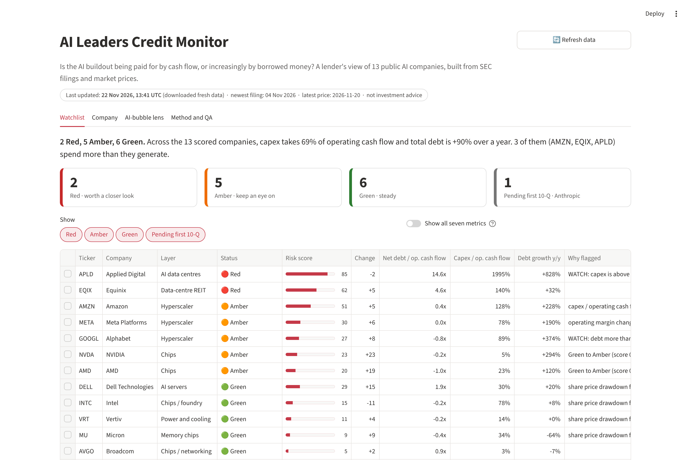
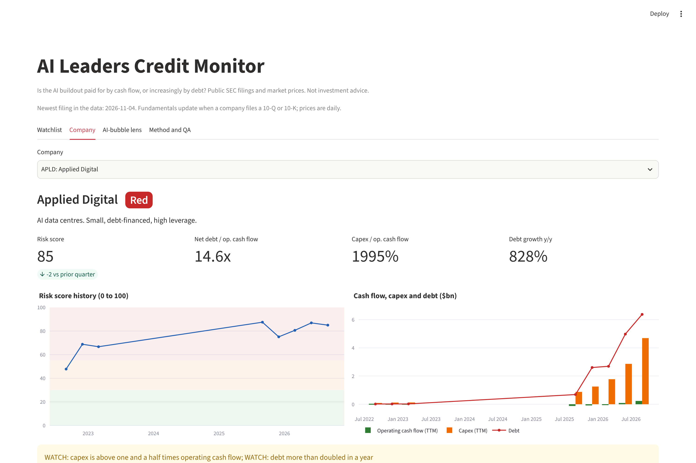
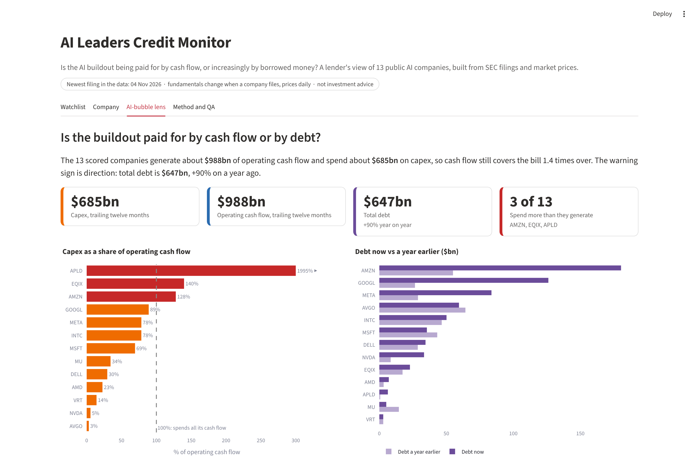
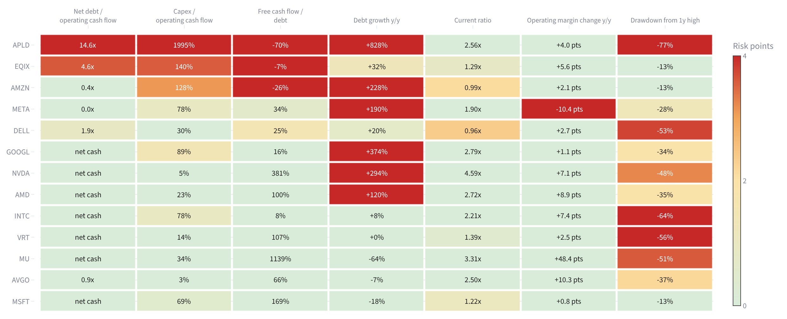

# AI Leaders Credit Monitor

**Is the AI buildout being paid for by cash flow, or increasingly by borrowed money?**
A credit-style monitor for 13 public AI-infrastructure companies, built from SEC filings and market prices. Each company gets a transparent 0 to 100 risk score, a Green / Amber / Red status, alerts when thresholds are breached, and a short credit note whose numbers are filled in by code and checked by a verifier. Anthropic is listed last and is scored once its first 10-Q is filed.

Demonstration on public data. Not investment advice.

Full write-up: [docs/PROJECT_REPORT.md](docs/PROJECT_REPORT.md) (purpose, universe, data, scoring, architecture, verification, results, limits, next steps).



## What it shows today

Snapshot of the data in this repo (newest filing 4 Nov 2026):

- Across the 13 scored companies, trailing-twelve-month capex is about $685bn against operating cash flow of about $988bn, and total debt is about $647bn, up about 90% year on year.
- Three names spend more on capex than they generate in operating cash flow: Amazon, Equinix and Applied Digital.
- Red: Applied Digital, Equinix. Amber: Amazon, Meta, Alphabet, NVIDIA, AMD (mostly because debt has more than doubled in a year). Green: Dell, Intel, Vertiv, Micron, Broadcom, Microsoft.

Read these as screening results from a judgment-based scorecard, not as verdicts (see Limits).

| Company view | AI-bubble lens |
| --- | --- |
|  |  |

The watchlist also shows where each score comes from: one cell per company and metric, coloured by risk points, with the actual value printed in the cell.



## Run it

```bash
pip install -r requirements.txt
python run.py            # uses cached SEC data and prices; add --refresh to re-download
streamlit run app.py     # dashboard
python -m pytest -q tests
```

The dashboard has a **Refresh data** button at the top. It runs `python run.py --refresh` (downloads the latest filings and prices, rebuilds everything) and the header shows when that last finished (`output/last_run.json`, UTC).

Set `SEC_USER_AGENT` to a descriptive string with your contact details before using `--refresh` (SEC fair-access policy). The repo ships processed results (`data/processed`, `output/`), so the dashboard works straight after cloning; only the large raw SEC cache is git-ignored.

## Daily refresh (GitHub Actions)

`.github/workflows/daily-refresh.yml` runs `python run.py --refresh --require-prices` and the tests at **05:00 IST (23:30 UTC) Tuesday to Saturday**, which is after the US market close, so each run picks up the previous US trading day. If anything changed it commits `data/processed` and `output` to `main`; the dashboard's "Last updated" stamp comes from `output/last_run.json`, so the daily commit always carries at least that file.

What actually moves: prices change every trading day, so the drawdown metric and the scores that use it move daily. The other six metrics come from filings, so they only change when a company files a 10-Q or 10-K (about four times a year each), which is when the status can change materially.

One-time setup: add a repository **variable** named `SEC_USER_AGENT` (Settings, Secrets and variables, Actions, Variables) such as `AI Credit Monitor your-name your-email`; the SEC requires automated clients to identify themselves, and the job stops with a clear error if it is missing. The job also stops, without committing, if the SEC download fails, data QA fails, or any company has no prices, so a Yahoo outage never overwrites good data. A failed run shows in the Actions tab and GitHub emails the repository owner. You can also start a run from the Actions tab with **Run workflow**.

## How it works: eleven agents, one orchestrator

Each agent has one job and writes a file, so any stage can be rerun and inspected. Every agent except the Writer is deterministic code.

| # | Agent | Module | Job |
| --- | --- | --- | --- |
| 0 | Orchestrator | `run.py` | Runs five stages in order, stops at a failed gate, logs the run (`output/run_log.json`) |
| 1 | Universe | `universe.py` | Tickers, CIKs; holds Anthropic as pending until a 10-Q/10-K revenue figure is tagged |
| 2 | Filings | `filings.py` | SEC company facts, cached and rate-limited |
| 3 | Market | `market.py` | Daily prices, one-year-high drawdown |
| 4 | Tag-mapper | `tagmap.py` | XBRL tags to standard items; quarterly and TTM series dated by filing date |
| 5 | Data QA | `qa.py` | Cross-checks; can stop the run |
| 6 | Metrics | `metrics.py` | Seven credit ratios per quarter |
| 7 | Scoring | `scoring.py` | Points, weights, score, status, triggers, "why it moved" |
| 8 | Alerts | `alerts.py` | Metric breaches, status changes, AI-bubble lens totals |
| 9 | Writer | `writer.py` | Drafts notes as prose with placeholders, never digits |
| 10 | Verifier | `verifier.py`, `mutation.py` | Six checks per note, then a mutation test |
| 11 | Publisher | `publisher.py`, `app.py` | Watchlist CSV, alert digest, verified notes, dashboard |

Gates: all active companies downloaded; data QA passes; only verified notes are published.

## Method

All inputs are items that every company tags reliably: revenue, operating income, operating cash flow, capex, cash, short-term investments, debt, current assets and liabilities. Debt = long-term (noncurrent plus current) plus short-term borrowings as reported. Net debt = debt minus cash and short-term investments.

| Metric | Weight | 0 risk points | 4 risk points |
| --- | --- | --- | --- |
| Net debt / operating cash flow | 25 | 1x or less (or net cash) | 5x or more |
| Capex / operating cash flow | 20 | 60% or less | 150% or more |
| Free cash flow / debt | 15 | 40% or more (or net cash) | 0% or less |
| Debt growth, year on year | 15 | 10% or less | 100% or more |
| Current ratio | 10 | 1.5x or more | 0.8x or less |
| Operating margin change, year on year | 5 | flat or up | down 10 points |
| Drawdown from one-year high | 10 | under 15% | 55% or more |

Points are linear between five thresholds per metric (`config/score_config.yaml`). Score = weighted points rescaled to 0 to 100 over the metrics available; under 60% of the weight available means "Not rated: limited data". Green below 30, Amber 30 to 55, Red above 55.
Hard trigger (forces Red): operating cash flow not positive while debt is outstanding. Watch triggers (force at least Amber): capex above 150% of operating cash flow, or debt more than doubled in a year.
History is point-in-time: each quarter is scored only with data filed by then.

## Verified notes

The Writer never types a number. It writes placeholders such as `{capex_to_cfo}`; the Verifier fills them from the computed tables only after six checks pass: (1) no raw digits, (2) every placeholder is a known metric with a value for that company, (3) direction words (rose, fell) agree with the sign and qualitative claims agree with the data, (4) citations are SEC filings actually used, (5) the watch level and status wording match the rules and there is no buy/sell language, (6) all five sections are present. A failing note goes to `output/needs_review/` and is never published.

The mutation test corrupts each note in up to ten ways (typed number, unknown metric, flipped direction, invented filing, wrong level, advice language, missing section, wrong status wording, unavailable value, false claim). Result in `output/mutation_report.md`. This tests that the checks fire; it is a regression test, not a measure of how well they would catch errors nobody thought of.

The default writer is a template. With `AICM_USE_LLM=1` and `ANTHROPIC_API_KEY` set (and `pip install anthropic`), an LLM drafts the prose under the same rules and the same Verifier. That path has not been run in this repo's tests because no API key was available.

## Data QA

`output/qa_report.md`: two independent TTM algorithms must agree (year-to-date arithmetic vs the sum of four discrete quarters), reported total-debt and cash-plus-investments tags must roughly match ours where they exist, values must be in plausible ranges, and fiscal-year-end TTM must equal the 10-K's annual figure for Microsoft, NVIDIA and Meta (this last check mostly confirms period selection and units).

## Limits

- **Universe:** Oracle, CoreWeave and Super Micro are excluded because their recent filings do not tag total debt cleanly; Oracle and CoreWeave are among the most debt-funded AI builders, so the aggregate picture looks calmer than the whole market. Nebius and IREN were excluded at the owner's request.
- **Off-balance-sheet financing** (data-centre joint ventures, leases not yet started) is not in reported debt, so leverage can be understated for some hyperscalers.
- **Scorecard:** weights and thresholds are judgment, not estimated. Equinix is a REIT whose capex is growth spending, so it scores Red mainly on structure. Debt-doubling triggers put several cash-rich names (NVIDIA, AMD, Alphabet) on Amber.
- **Debt tags differ by company** (see `debt_source` in `data/processed/metrics.csv`). Micron's reported `LongTermDebt` tag disagrees with our figure, which includes finance leases; QA flags it.
- **Market signal:** a share price drop is an equity signal, not a credit signal. Bond prices, CDS spreads and ratings are not free and are not used.
- **Not daily fundamentals:** balance sheets and cash flows change only when a company files; prices and the drawdown are daily.
- **Anthropic** has only a registration statement so far and is shown as "Pending first 10-Q".
- Prices come from Yahoo Finance's unofficial chart endpoint.

## Layout

```
config/    universe.yaml  tag_map.yaml  score_config.yaml
src/aicm/  the eleven agents (above) and shared helpers
run.py     orchestrator          app.py   Streamlit dashboard
data/processed/  metrics, scores, alerts, AI-bubble lens (committed)
output/    watchlist.csv  alerts.md  notes/  needs_review/  qa_report.md  mutation_report.md  run_log.json
tests/     TTM, scoring and verifier tests
```
